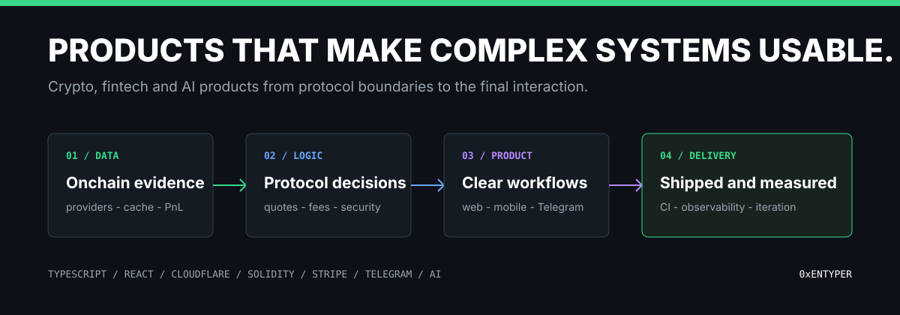
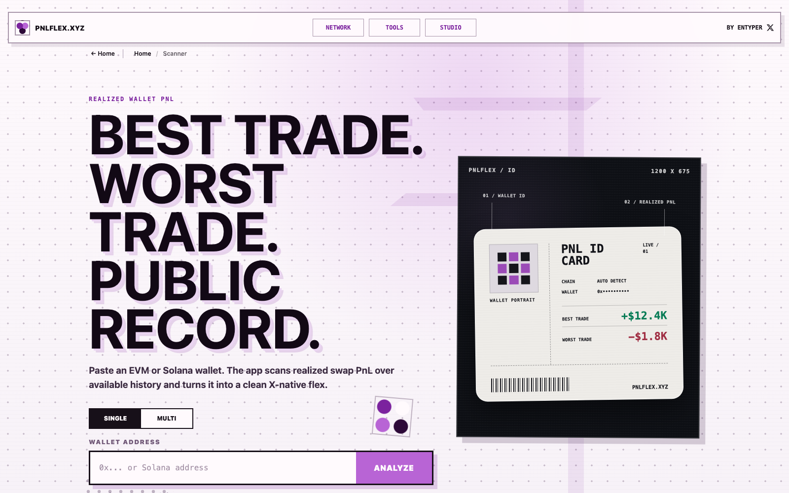
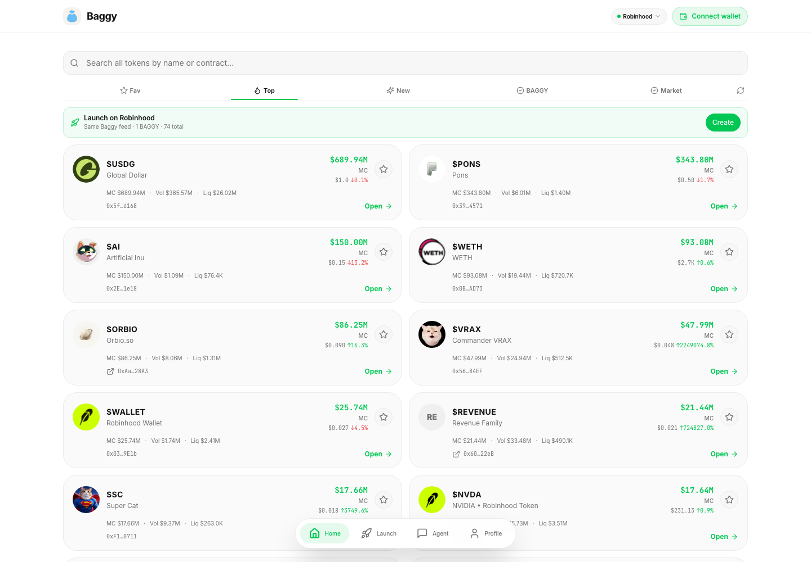
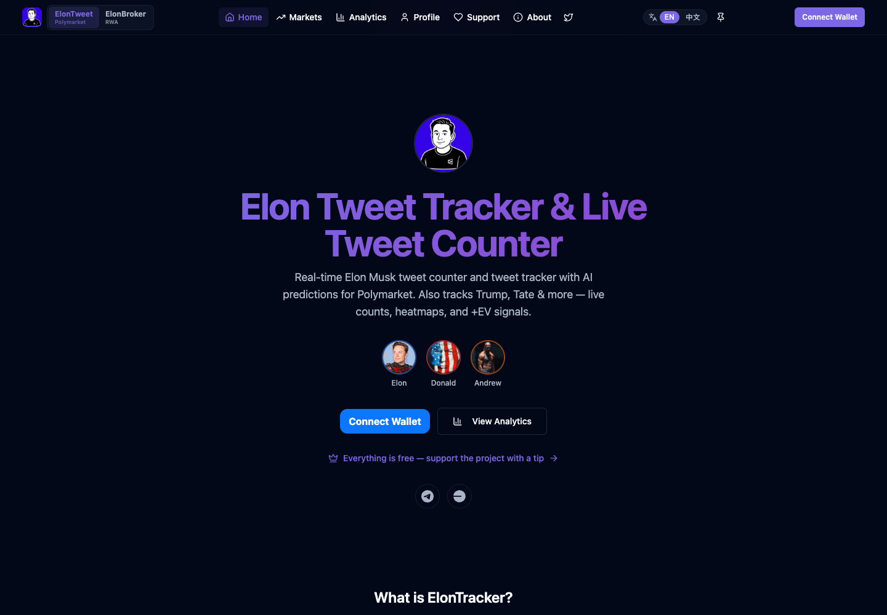
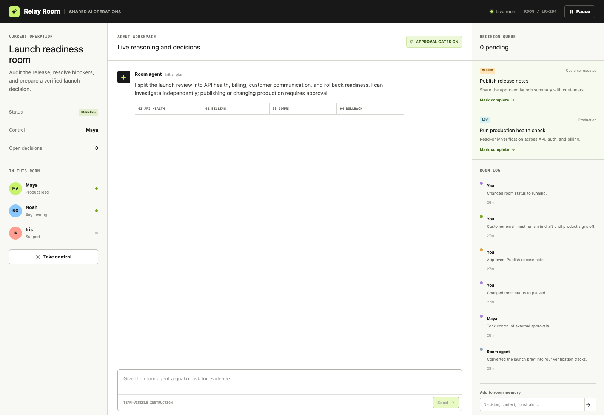

# 0xENTYPER

**Product engineer building AI, SaaS, fintech, and data-intensive products.**

[Portfolio](https://entyper.dev) · [X](https://x.com/entyper) · [Live products](#selected-products) · [Engineering labs](#engineering-labs)

I work from the product decision down to the infrastructure: interface design, application architecture, AI workflows, payments, data quality, automation, and production delivery.

## Selected products

<table>
  <tr>
    <td width="50%" valign="top">
      
      <h3><a href="https://github.com/0xENTYPER/pnlflex">PNLFlex</a></h3>
      
Wallet intelligence and a visual publishing studio for creators.

      
<strong>Role:</strong> Product · Design · Frontend · Backend · Infrastructure

      
<a href="https://pnlflex.xyz">Live product</a> · Multi-chain market data · Shareable visual output

    </td>
    <td width="50%" valign="top">
      
      <h3><a href="https://github.com/0xENTYPER/baggy">Baggy</a></h3>
      
Multi-chain token discovery, launch, trading, and portfolio context.

      
<strong>Role:</strong> Product · Design · Full stack · Protocol UX

      
<a href="https://baggyapp.win">Live product</a> · Web and Telegram · Launch infrastructure

    </td>
  </tr>
  <tr>
    <td width="50%" valign="top">
      
      <h3><a href="https://github.com/0xENTYPER/elon-tracker">ElonTracker</a></h3>
      
AI analytics for prediction markets with paid access and Telegram delivery.

      
<strong>Role:</strong> Product · AI pipeline · Billing · Analytics

      
<a href="https://elon-tracker.com">Live product</a> · Stripe subscriptions · Production signals

    </td>
    <td width="50%" valign="top">
      
      <h3><a href="https://github.com/0xENTYPER/shared-ai-operations-room">Relay Room</a></h3>
      
A shared operations room for AI work that needs state, handoff, and control.

      
<strong>Role:</strong> Product concept · UX · Realtime architecture

      
Shared state · Approval gates · Durable decision log

    </td>
  </tr>
</table>

## AI systems

| Product | Workflow | Engineering boundary |
| --- | --- | --- |
| [Reply Ops](https://github.com/0xENTYPER/reply-ops) | Research, generation, ranking, approval, browser execution | Local-first context and explicit human approval |
| [Scout Agent](https://github.com/0xENTYPER/scout-agent) | Web QA, evidence capture, isolated repair candidates | Bounded authority and repeatable verification |
| [Treasury Manager](https://github.com/0xENTYPER/orbio-agent-treasury-manager) | Agent treasury policy and paid-action review | Budgets, policy checks, and approval before execution |

## Production evidence

| | Evidence |
| --- | --- |
| **Live systems** | [PNLFlex](https://pnlflex.xyz) · [Baggy](https://baggyapp.win) · [ElonTracker](https://elon-tracker.com) |
| **Verification** | 70 highlighted checks across product logic, gateways, AI operations, and calculation engines |
| **AI controls** | Approval gates, bounded repairs, cancellation, retries, and auditable state |
| **Infrastructure** | Cloudflare Workers, Stripe, Telegram, browser automation, SQLite, PostgreSQL, and onchain providers |
| **Network coverage** | Ethereum, Base, BNB Chain, Arbitrum, Optimism, Polygon, Avalanche, and Solana |

## Engineering labs

| Repository | What it investigates |
| --- | --- |
| [web3-observability-lab](https://github.com/0xENTYPER/web3-observability-lab) | Provider availability, latency, data drift, cache behavior, and operational evidence |
| [stripe-web3-entitlements](https://github.com/0xENTYPER/stripe-web3-entitlements) | Turning verified billing events into durable product access |
| [wallet-pnl-lab](https://github.com/0xENTYPER/wallet-pnl-lab) | Realized PnL without inventing missing cost basis |
| [arbitrage-betting-engine](https://github.com/0xENTYPER/arbitrage-betting-engine) | Executable cross-book arbitrage with worst-case payout proofs |
| [multi-chain-token-resolver](https://github.com/0xENTYPER/multi-chain-token-resolver) | One defensible market snapshot across EVM and Solana |
| [bonding-curve-simulator](https://github.com/0xENTYPER/bonding-curve-simulator) | Keeping frontend quotes consistent with contract economics |

## Selected stack

`TypeScript` · `React` · `Cloudflare Workers` · `Node.js` · `Python` · `Playwright` · `PostgreSQL` · `SQLite` · `Stripe` · `Telegram` · `Solidity`

---

Built by [0xENTYPER](https://github.com/0xENTYPER)
